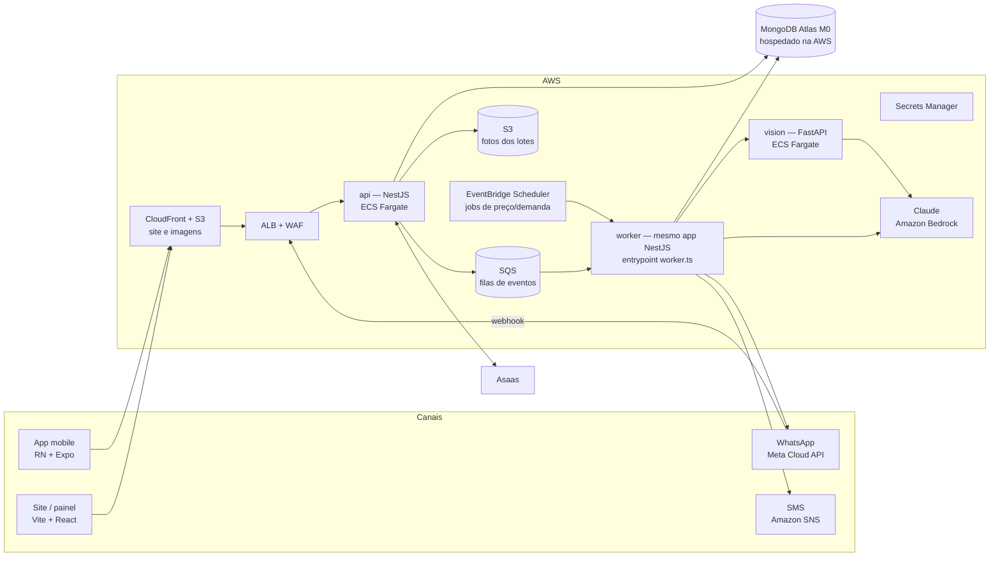

# Arquitetura — Colheita Direta

> Documento de referência técnica. Toda decisão aqui vale para todos os apps e serviços do monorepo.
> Concepção do produto: [`concepcao.md`](./concepcao.md) · Checklists de execução: [`checklists/`](./checklists/README.md)

## 1. Decisões fixas

| Tema | Decisão |
|---|---|
| Repositório | Monorepo **Turborepo + pnpm workspaces** |
| Backend | **NestJS** (TypeScript), sempre **classes**, **SOLID** e **clean code** |
| Visão computacional | **FastAPI** (Python), classes de serviço + **Pydantic** para todas as interfaces (request/response/config) |
| Web | **React + Vite**, componentes **funcionais**, **React Query**, **Tailwind**, **Ant Design** |
| Mobile | **React Native (Expo)**, componentes **funcionais**, **React Query**, **NativeWind** (Tailwind), **@ant-design/react-native** |
| Design system | **LeafyGreen (design.mongodb.com)** como fonte única de tokens (cores, tipografia, espaçamento); Ant Design e Tailwind tematizados com esses mesmos tokens |
| Banco de dados | **MongoDB Atlas** (cluster **M0 gratuito**, provedor AWS, região mais próxima do ECS) via **Mongoose** (`@nestjs/mongoose`). Upgrade para M10+ quando for para produção |
| Nuvem | **Toda a infraestrutura na AWS**, provisionada com **Terraform** (inclusive o Atlas, via provider `mongodbatlas`). Externos: MongoDB Atlas (hospedado na AWS), Asaas e Meta |
| Pagamentos | **Asaas** (Pix, boleto, cartão, **split** entre produtor, transportador e plataforma; subcontas por vendedor) |
| WhatsApp | **Meta WhatsApp Cloud API direto** (Graph API), sem BSP. Em runtime o backend chama só a Graph API |
| Setup da Meta | **MCP do Facebook/Meta conectado ao Claude Code**: o Claude cria e configura tudo na conta Meta do projeto, de ponta a ponta (app, WhatsApp Business Account, número, webhook, templates, catálogo de produtos e serviços) |
| SMS | **Amazon SNS / AWS End User Messaging** (fallback quando não houver WhatsApp) |
| IA generativa | **Claude via Amazon Bedrock** — agente conversacional com *tools* e Claude Vision no MVP da classificação |
| Offline no app | Sem SQLite: cache do React Query persistido (MMKV/AsyncStorage) + **fila de mutações offline** reenviada ao reconectar |

## 2. Visão geral



**Princípio:** a `api` responde rápido e publica eventos; tudo que é lento (classificar foto, falar com o Claude, enviar WhatsApp/SMS, recalcular preço) roda no `worker` via SQS.

## 3. Estrutura de pastas

```
colheita-direta/
├── apps/
│   ├── api/            # backend NestJS: main.ts (HTTP + webhooks) e worker.ts (filas SQS e jobs)
│   ├── web/            # site + painéis (Vite + React)
│   └── mobile/         # app produtor / comprador / transportador (Expo)
├── services/
│   └── vision/         # classificação de qualidade e pragas (FastAPI)
├── packages/
│   ├── contracts/      # tipos e schemas (zod) compartilhados entre api, web e mobile
│   ├── api-client/     # cliente HTTP + hooks React Query reutilizados por web e mobile
│   ├── design-tokens/  # tokens LeafyGreen → preset Tailwind + tema Ant Design
│   ├── ui-web/         # componentes web reutilizáveis (Ant Design tematizado)
│   └── config/         # tsconfig, eslint, prettier, jest compartilhados
├── infra/
│   └── terraform/
│       ├── modules/        # network, ecs-service, s3-cdn, sqs-queue, atlas-cluster, secrets...
│       └── environments/
│           ├── dev/
│           └── prod/
├── docs/
├── turbo.json
├── pnpm-workspace.yaml
└── package.json
```

### 3.1 Backend NestJS (`apps/api`)

**Um app, dois entrypoints:** `main.ts` sobe o HTTP e `worker.ts` sobe só os consumidores de fila. Os dois usam **os mesmos módulos e use-cases** (zero duplicação), saem da **mesma imagem Docker** e rodam como **dois serviços ECS** com escala independente.

Um módulo por domínio. Todo módulo tem **as mesmas pastas**, para que qualquer pessoa ache qualquer coisa:

```
apps/api/src/
├── main.ts                  # entrypoint HTTP
├── worker.ts                # entrypoint consumidores SQS / jobs
├── app.module.ts
├── modules/
│   ├── producers/
│   │   ├── entities/            producer.entity.ts           # regra de negócio pura, sem framework
│   │   ├── repositories/        producer.repository.ts       # interface (contrato)
│   │   │                        mongo-producer.repository.ts # implementação Mongoose
│   │   ├── schemas/             producer.schema.ts           # schema Mongoose
│   │   ├── use-cases/           register-producer.use-case.ts
│   │   │                        update-producer-profile.use-case.ts
│   │   ├── controllers/         producers.controller.ts       # valida com o schema zod de @colheita/contracts
│   │   └── producers.module.ts
│   ├── harvest-lots/        # lotes de colheita + classificação
│   ├── marketplace/         # catálogo, ofertas, carrinho
│   ├── orders/              # pedidos e status
│   ├── payments/            # Asaas (subcontas, cobranças, split, webhooks)
│   ├── buyers/              # compradores (varejo, restaurante, indústria, PNAE, consumidor)
│   ├── service-providers/   # prestadores intermediários: transporte, armazenagem refrigerada,
│   │                        # beneficiamento/embalagem, classificação, assistência técnica
│   ├── lot-routing/         # confirma o destino do lote e o envia ao canal certo (oferta, doação...)
│   ├── impact-indicators/   # KPIs do piloto
│   ├── health/              # /health para o load balancer
│   ├── surplus/             # ONGs e doações (leilão na v1)
│   ├── farm-management/     # colheita, estoque, financeiro do produtor
│   ├── notifications/       # WhatsApp, SMS, push (uma interface, vários canais)
│   ├── assistant/           # agente Claude e suas tools
│   ├── market-intelligence/ # preços, demanda, indicadores
│   └── identity/            # usuários, OTP, papéis (RBAC)
└── shared/
    ├── database/            # conexão MongoDB Atlas (Mongoose)
    ├── queue/               # publisher/consumer SQS
    ├── storage/             # S3
    ├── errors/              # exceções de domínio + filtro HTTP
    ├── auth/                # JWT, papéis, decorators @PublicRoute/@Roles/@CurrentUser
    ├── validation/          # ZodValidationPipe + @ValidatedBody (schemas compartilhados)
    ├── geo/                 # distância e GeoJSON
    └── config/              # variáveis de ambiente validadas com zod
```

**Regras:**
- **Sempre classes.** Use-case = uma classe com um método `execute()`.
- **S** — uma classe, uma responsabilidade (`CreateHarvestLotUseCase` não envia WhatsApp; publica evento).
- **O / L** — canais de notificação implementam `NotificationChannel`; novo canal = nova classe, nada muda no resto.
- **I** — interfaces pequenas (`ProducerRepository` só com o que o domínio usa).
- **D** — use-cases dependem de **interfaces** (`ProducerRepository`, `PaymentGateway`, `QualityClassifier`), injetadas por *token* do Nest. Asaas, MongoDB, Meta e Bedrock ficam só na implementação.
- Controllers só validam a entrada e chamam use-case. Nenhuma regra de negócio em controller ou schema.
- **Uma única fonte de contrato:** a entrada é validada com os schemas zod de `packages/contracts` (`@ValidatedBody(createHarvestLotSchema)`), os mesmos usados pelo web e pelo mobile. O Swagger é gerado desses schemas. Não há DTOs duplicados com `class-validator`.
- Dependências entre módulos são de mão única. Quando duas features precisam uma da outra, um módulo orquestrador fica acima delas (ex.: `lot-routing` usa `harvest-lots`, `marketplace` e `surplus`).

Exemplo de nomes esperados:

```ts
export class ClassifyHarvestLotUseCase {
  constructor(
    @Inject(HARVEST_LOT_REPOSITORY) private readonly harvestLotRepository: HarvestLotRepository,
    @Inject(QUALITY_CLASSIFIER) private readonly qualityClassifier: QualityClassifier,
    @Inject(EVENT_PUBLISHER) private readonly eventPublisher: EventPublisher,
  ) {}

  async execute(input: ClassifyHarvestLotInput): Promise<HarvestLotClassification> { /* ... */ }
}
```

### 3.2 Visão computacional (`services/vision`)

```
services/vision/
├── app/
│   ├── main.py                       # cria o FastAPI e registra rotas
│   ├── routes/
│   │   ├── quality_routes.py         # POST /quality/classify
│   │   └── pest_routes.py            # POST /pests/diagnose
│   ├── schemas/                      # Pydantic: contratos de entrada e saída
│   │   ├── quality_schemas.py        # QualityClassificationRequest / Response
│   │   └── pest_schemas.py
│   ├── services/                     # classes com a regra
│   │   ├── quality_classifier_service.py
│   │   └── pest_diagnosis_service.py
│   ├── classifiers/                  # estratégias trocáveis (mesma interface)
│   │   ├── base_classifier.py        # classe abstrata ImageClassifier
│   │   ├── claude_vision_classifier.py   # MVP: Claude Vision (Bedrock) com saída validada por Pydantic
│   │   └── simulated_classifier.py   # desenvolvimento sem credenciais (nunca em produção)
│   ├── dependencies.py               # injeção: escolhe o classificador pela configuração
│   └── settings.py                   # Pydantic Settings (variáveis de ambiente)
├── training/                         # notebooks e scripts de treino/avaliação
├── tests/
└── pyproject.toml
```

Na v1 entra `trained_model_classifier.py` (modelo próprio, ver `services/vision/training/README.md`). Trocar o classificador é só trocar a classe injetada — mesma interface `ImageClassifier`. As fotos são normalizadas antes (rotação, tamanho máximo, regravação em JPEG que remove EXIF/GPS).

### 3.3 Web (`apps/web`) e Mobile (`apps/mobile`)

Organização **por funcionalidade** (*feature*), não por tipo de arquivo:

```
apps/web/src/
├── main.tsx
├── app/                 # providers (QueryClient, Ant Design ConfigProvider, rotas)
├── pages/               # uma página = composição de features
│   ├── home-page.tsx
│   ├── marketplace-page.tsx
│   ├── offer-page.tsx
│   └── producer-page.tsx
├── features/
│   ├── catalog/
│   │   └── components/  offer-card.tsx, offer-filters.tsx
│   ├── cart/hooks/      use-cart.tsx
│   ├── harvest-lots/    new-harvest-lot-form.tsx, destination-chooser.tsx
│   ├── orders/          order-list.tsx, pix-payment-panel.tsx
│   ├── donations/  farm-management/  impact/  signup/  auth/
├── layout/
└── utils/
```

O mobile segue o mesmo padrão (`screens/` no lugar de `pages/`, componentes em `src/components/`). No MVP o app é focado no **produtor** (foto, classificação, destino, pedidos, gestão); comprador, ONG e prestador usam o site.

**Mobile, detalhes importantes:**
- **Offline:** o cache do React Query é persistido no AsyncStorage e a criação de lote é uma mutação com `mutationKey` e `setMutationDefaults`. Sem sinal, ela fica pausada e salva, e é reenviada quando a internet volta, mesmo que o app tenha sido fechado.
- **Monorepo:** o `metro.config.js` força uma única cópia de `react`, `react-native` e `@tanstack/react-query`. Sem isso, os hooks de `packages/api-client` usariam outra instância e quebrariam.
- **Ant Design RN:** importar de `@ant-design/react-native/lib/<componente>`. O índice do pacote carrega o Drawer, que não é compatível com o `react-native-gesture-handler` 3 do Expo SDK 58.

**Regras:**
- Só componentes **funcionais** e hooks.
- **Todo acesso a dados via React Query**, usando os hooks de `packages/api-client` (ex.: `useHarvestLots()`, `useCreateOrder()`). Nenhum `fetch` solto em componente.
- Componente usado em 2 lugares → sobe para `packages/ui-web` (ou para um `packages/ui-mobile` quando existir um segundo app React Native).
- Nomes de arquivo em `kebab-case`, componentes em `PascalCase`, hooks começam com `use`.

### 3.4 Design system

`packages/design-tokens` é a **única fonte de cores**. Ele reexporta a paleta do LeafyGreen (`@leafygreen-ui/palette`) e gera:

- `tailwind-preset.ts` → usado por web (Tailwind) e mobile (NativeWind);
- `ant-design-theme.ts` → `ThemeConfig` do Ant Design (`colorPrimary`, `colorError`, `fontFamily`, `borderRadius`...).

```ts
import { palette } from '@leafygreen-ui/palette';

export const antDesignTheme: ThemeConfig = {
  token: {
    colorPrimary: palette.green.dark2,
    colorSuccess: palette.green.base,
    colorError: palette.red.base,
    colorWarning: palette.yellow.base,
    colorInfo: palette.blue.base,
    colorTextBase: palette.black,
  },
};
```

E também `ant-design-mobile-theme.ts`: o `@ant-design/react-native` **não usa** o `ThemeConfig` do web; recebe um objeto de tema próprio, gerado dos mesmos tokens.

**Tailwind + Ant Design no web:** o *preflight* (reset CSS) do Tailwind pode sobrescrever estilos do AntD v5 (botões principalmente). Usar `@layer` com `StyleProvider` do AntD (`layer`) ou desativar o preflight — decidir na fundação e cobrir com teste visual.

Nenhum app escreve cor em hexadecimal; sempre token.

## 4. Fluxos principais

### 4.1 Foto → classificação → destino do lote
1. Produtor envia foto (app ou WhatsApp) → `api` salva no S3 e cria `HarvestLot` com status `PENDING_CLASSIFICATION` → publica `harvest-lot.created`.
2. `worker` chama `vision` → recebe `{ grade: A|B|C|D, confidence, defects[], estimatedWeightKg }`.
3. `RouteHarvestLotUseCase` decide o destino:
   - **A/B** → oferta no marketplace com **preço sugerido** (`market-intelligence`);
   - **C** → leilão de excedente ou indústria (insumo, polpa, ração vegetal);
   - **D** → doação para ONG/banco de alimentos ou compostagem;
   - baixa confiança → confirmação humana do produtor.
4. `notifications` avisa o produtor pelo WhatsApp com botões: **Publicar / Ajustar preço / Mudar destino**.

### 4.2 Pedido com serviços intermediários e split
Pedido → serviços necessários (frete, e opcionalmente armazenagem refrigerada, embalagem/beneficiamento) cotados com **prestadores cadastrados** na região → cobrança Asaas com **split** (produtor + cada prestador + taxa da plataforma) → webhook de pagamento → entrega rastreada → liberação do repasse.

### 4.3 Conversa no WhatsApp
Webhook Meta → `assistant` (Claude) com tools: `createHarvestLot`, `getSuggestedPrice`, `listMyOrders`, `diagnosePest`, `getStockSummary`, `registerExpense`. Mensagens proativas (fora da janela de 24h) só com **templates aprovados**.

## 5. Componentes AWS (Terraform)

| Módulo Terraform | Recursos |
|---|---|
| `network` | VPC, subnets públicas/privadas, NAT, VPC endpoints |
| `ecs-service` | Cluster ECS Fargate, task definitions, autoscaling: `api-http` e `api-worker` (mesma imagem, comandos diferentes) e `vision` |
| `load-balancer` | ALB, certificados ACM, WAF |
| `s3-cdn` | S3 + CloudFront para o site e para fotos (URLs assinadas) |
| `sqs-queue` | Filas + DLQ por evento |
| `scheduler` | EventBridge Scheduler (preços diários, previsão de demanda, lembretes) |
| `atlas-cluster` | Provider `mongodbatlas`: projeto, cluster M0 (dev) / M10+ (prod), usuário do banco, *IP access list* com o IP fixo do NAT Gateway |
| `bedrock` | Acesso aos modelos Claude no Bedrock, políticas IAM por serviço, VPC endpoint |
| `secrets` | Secrets Manager (Asaas, Meta, string de conexão do Atlas) |
| `observability` | CloudWatch logs/alarms, X-Ray |
| `ci-deploy` | ECR, OIDC do GitHub Actions para deploy |

## 6. Segurança e LGPD
- Login por telefone com **OTP** (WhatsApp, fallback SMS); JWT curto + refresh.
- RBAC: `producer`, `buyer`, `carrier`, `ngo`, `cooperative`, `admin`.
- Dados pessoais e geolocalização: consentimento explícito, finalidade declarada, exportação e exclusão de conta.
- Fotos com URLs assinadas e expiração; nenhuma foto pública com EXIF de localização.
- Webhooks (Meta, Asaas) com validação de assinatura/token.
- Segredos só no Secrets Manager; acesso a Bedrock, S3, SQS e SNS por **IAM role** da task (sem chaves fixas).

### Pontos a verificar na fundação
- **(verificar)** Disponibilidade dos modelos Claude no Bedrock, do Transcribe e do Polly pt-BR em `sa-east-1` (São Paulo). Se exigir *cross-region inference*, registrar no mapa de dados da LGPD (transferência de dados).
- **(verificar)** Se o Asaas permite **reter o split até a entrega** (custódia). Se não permitir, não reter valores na plataforma sem análise regulatória; alternativa: cobrança só após aceite do produtor + política de reembolso.

### Observações sobre o MongoDB Atlas M0 (gratuito)
- **Limites do M0:** 512 MB de armazenamento, recursos compartilhados, sem backups automáticos, **sem VPC peering/PrivateLink** e limite de conexões. Serve para desenvolvimento, demo e início do piloto.
- **Acesso:** as tasks ECS saem pelo NAT Gateway (Elastic IP fixo) → só esse IP na *IP access list* do Atlas; conexão sempre TLS (`mongodb+srv`). Nunca liberar `0.0.0.0/0`.
- **Pool de conexões:** `maxPoolSize` baixo por task (ex.: 10) para não estourar o limite do M0.
- **Fotos não vão para o banco:** imagens ficam no S3; o Mongo guarda só a chave.
- **Geoconsultas** (comprador/prestador mais próximo) com índice `2dsphere` e `$geoNear`, suportados normalmente.
- **(verificar)** Disponibilidade do M0 na região AWS escolhida (preferência `sa-east-1`).
- **Gatilho de upgrade para M10+:** uso > 70% do armazenamento, início da cobrança de clientes ou necessidade de backup/PrivateLink. A troca de tier não muda código.
- Desenvolvimento local com MongoDB em Docker.
